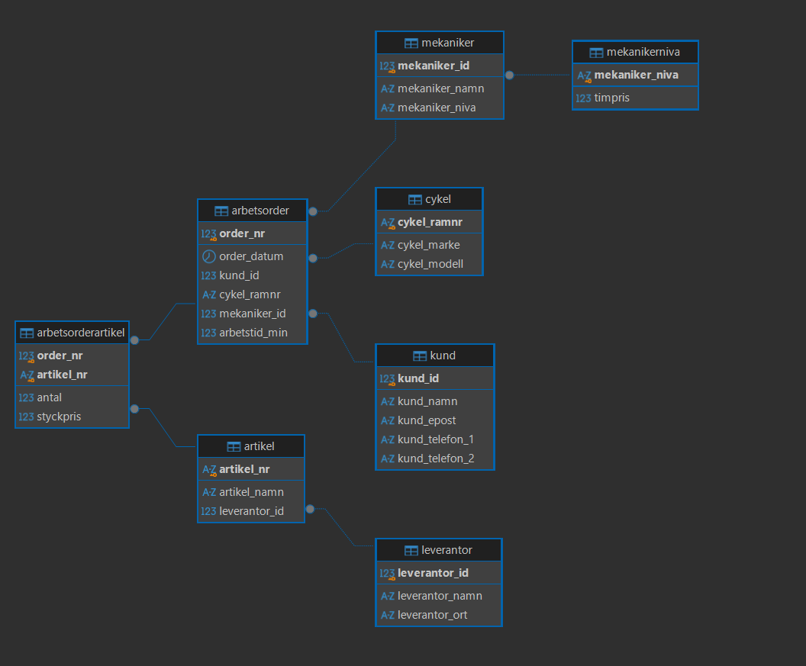

# Cykelverkstaden Trampen – Relationsdatabas

## Om projektet
Detta projekt genomfördes som en del av mina studier inom databasutveckling. Uppgiften gick ut på att omvandla exporterad data från en cykelverkstad till en strukturerad relationsdatabas med PostgreSQL.

Databasen hanterar information om kunder, cyklar, mekaniker, leverantörer, artiklar och arbetsordrar.

## ER-diagram

Nedan visas databasens struktur och relationerna mellan tabellerna.

## Tekniker
- PostgreSQL
- SQL
- DBeaver

## Vad projektet innehåller
- Relationsdatabasdesign och normalisering
- Primärnycklar (PK) och främmande nycklar (FK)
- Databasregler: NOT NULL, UNIQUE och CHECK
- Datamigrering med INSERT INTO och SELECT
- Datahämtning och verifiering med JOIN och LEFT JOIN
- Testning av databasregler och dataintegritet

## Databasens tabeller

Databasen består av åtta tabeller:

1. `kund` – Lagrar information om verkstadens kunder.
2. `cykel` – Lagrar information om kundernas cyklar.
3. `mekanikerniva` – Lagrar mekanikernivåer och tillhörande timpriser.
4. `mekaniker` – Lagrar information om verkstadens mekaniker.
5. `leverantor` – Lagrar information om leverantörer.
6. `artikel` – Lagrar information om artiklar och deras leverantörer.
7. `arbetsorder` – Lagrar information om verkstadens arbetsordrar.
8. `arbetsorderartikel` – Kopplar samman arbetsordrar med artiklar och innehåller antal och styckpris.
